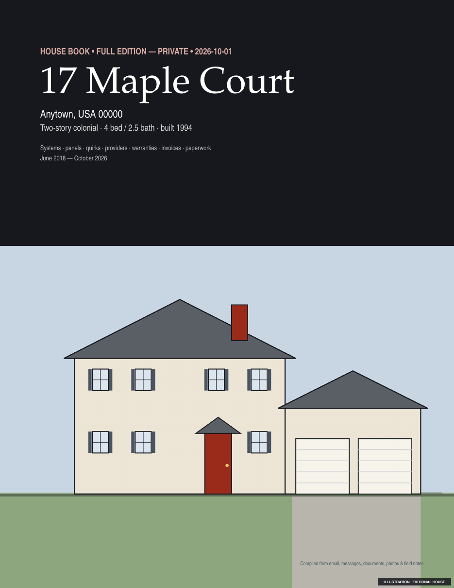
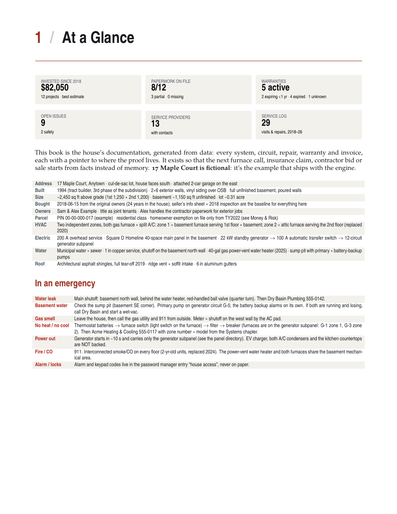
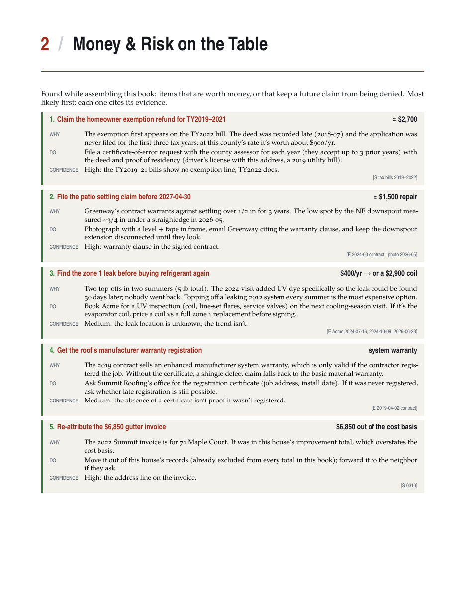
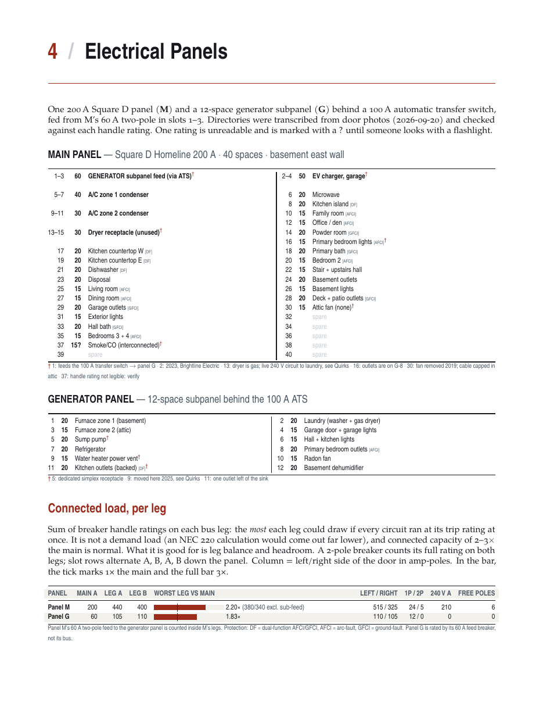
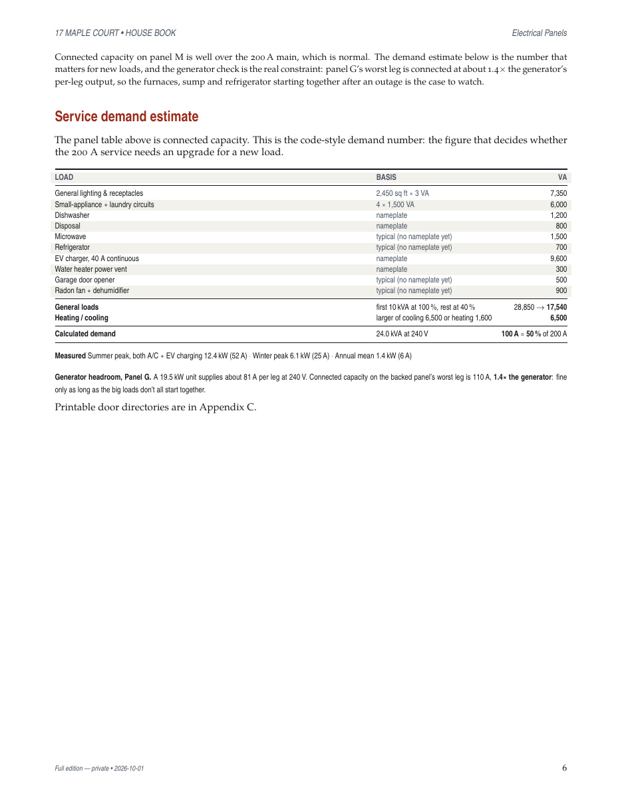
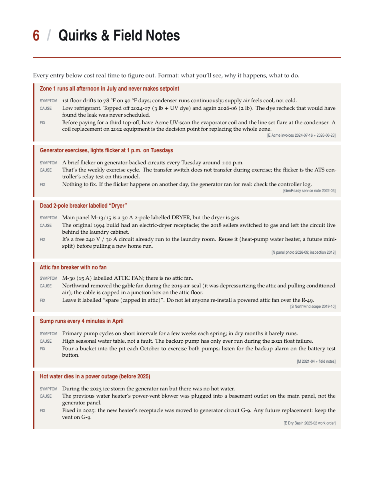
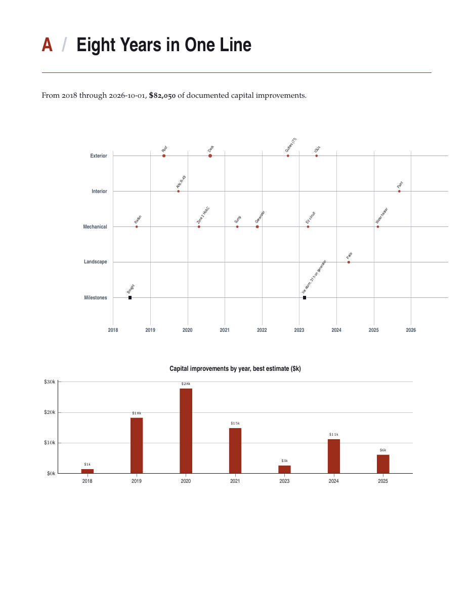
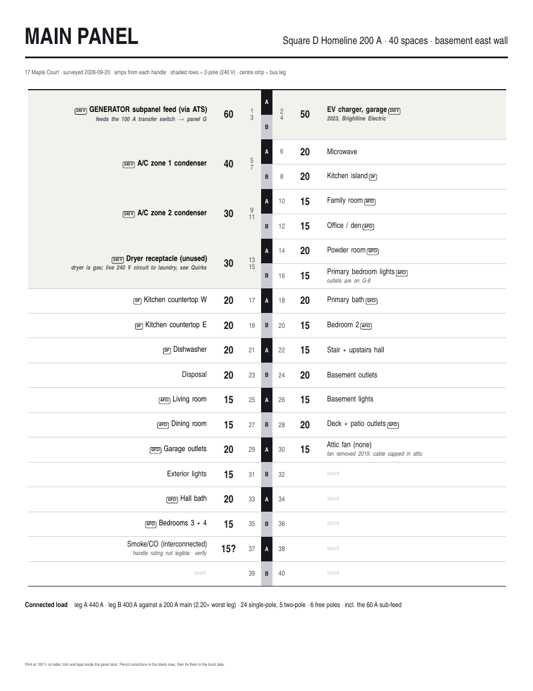

# house-book

**Treat your house like a codebase.** The facts about a house (systems, breaker panels, repairs, warranties,
invoices, quirks, who to call) live in plain Python data files. A generator renders them to LaTeX, and one command
builds a printable, cross-referenced **house book** in two editions: a private one and a shareable one.

The repo ships with a worked example, **17 Maple Court**, a *fictional* 1994 two-story house. Every name,
vendor, phone number (555-01xx), serial, amount and date in it is invented, and every image is a generated illustration.

| | |
|---|---|
| [`samples/17-Maple-Court-Book-full.pdf`](samples/17-Maple-Court-Book-full.pdf) | full edition, 29 pp: money & risk, finance, paperwork to chase, document index |
| [`samples/17-Maple-Court-Book-share.pdf`](samples/17-Maple-Court-Book-share.pdf) | share edition, 25 pp: private rows and chapters compiled out |
| [`samples/17-Maple-Court-Panel-Labels.pdf`](samples/17-Maple-Court-Panel-Labels.pdf) | printable breaker-panel door directories |

<p>
 
 
 
 
</p>

## What a house book is

Every house has a folder: a pile of email, scanned receipts, a photo library, a seller's info sheet, a breaker
directory in Sharpie on the inside of a panel door. None of it agrees with the rest, and none of it is in one place when
the furnace dies.

A house book is that folder compiled: one document with every system and its model number, every circuit, every
repair and what it cost, every warranty and when it expires, every recurring quirk and its fix, and where the proof
for each of those lives. Because it's generated from data, it stays current: you edit a row and rebuild, and nobody edits
the PDF by hand.

Putting everything in one place with sources tends to find things. The example house has a few of the usual ones:

- a refrigerant top-off with UV dye whose 30-day leak recheck never happened, followed by another top-off two years later;
- an installer warranty still in force that covers a defect that just appeared (patio settling);
- an invoice for the neighbor's house that had been counted in this house's cost basis (`exclude=True`);
- a homeowner tax exemption that was missed for three years;
- equipment capacities on the seller's sheet that don't match the nameplates;
- a dead 240 V circuit labelled "Dryer" (the dryer is gas), which is free capacity for a future heat pump.

## Chapters

At a Glance (tiles, facts, emergency shutoffs) · Money & Risk on the Table · Systems · Electrical Panels (directory,
per-leg connected capacity, NEC 220.82 demand estimate, generator headroom) · Compliance & Inspections · Quirks & Field
Notes · Service Providers · Warranties (ACTIVE / EXPIRING / EXPIRED computed against the build date) · Invoice Ledger ·
Ownership & Finance · Paperwork to Chase · Open Issues + project queue · Maintenance Calendar · appendices: N Years in
One Line (swimlane timeline + spend by year) · Improvements · Printable Panel Directories · Drawings & Plans ·
Equipment Manuals + nameplate walk-through · Document Index. Chapters with no data are left out. There's also a Units
chapter for multi-unit buildings.

## Pipeline

```
data*.py ──engine/gen.py──► tex/gen/*.tex (~35 fragments) + main.tex ──latexmk -xelatex──► out/*-Book-{full,share}.pdf
photos/orig/** ──photos.py──► print/ (1300 px) · web/{full,thumb}   (EXIF + GPS stripped from every derivative)
                                  └──gallery.py──► publish/ (static index.html + manifest + manuals) ──zip──► out/*-photos.zip
```

```
engine/gen.py        data → LaTeX fragments (projects, ledger, warranties, panels, loads, demand, timeline, ...)
engine/assemble.py   units / compliance / finance chapters, preamble placeholders, main.tex + cover
engine/preamble.tex  KOMA scrbook, dense zebra tables, status pills; fonts below
engine/photos.py     photo derivatives (ImageMagick)
engine/gallery.py    static, self-contained web photo index for the share package
build.sh             the only command
SCHEMA.md            the data contract
```

## Data contract (short version)

`data.py` defines plain Python lists and dicts. See [`SCHEMA.md`](SCHEMA.md) for every field, and
[`examples/maple-court/`](examples/maple-court/) for all of them in use.

```python
PROJECTS = [dict(short="Patio", cat="Landscape", title="Paver patio (380 sq ft)", vendor="Greenway Hardscapes",
                 date="2024-04-30", cost=11200, paid=11200, warranty="3 yr installer (to 2027-04-30)",
                 paperwork="have", sources=["E 2024-03 contract"])]
PANELS = [dict(id="G", title="GENERATOR PANEL", slots=12, main=60, fed=True, gen_kw=19.5, rows=[
    (1, "20", 1, "Furnace zone 1 (basement)", "", ""),
    (9, "15?", 1, "Water heater power vent", "", "handle rating not legible: verify")])]
```

- **Two editions from one source.** `private=True` on a dict row, or a trailing `True` on a tuple row, drops it from
  the share edition. Whole chapters (Money & Risk, Finance, Paperwork to Chase, Document Index) are full-only.
- **Every fact carries a source**: a citation code for wherever the proof lives (email, scan id, bank statement, photo).
- **Uncertainty is data.** `"15?"` prints as `15?`, so the next person with a flashlight knows which one to check.

## Start your own

Requirements: Python 3.9+, a TeX Live with XeLaTeX + latexmk (`brew install --cask mactex-no-gui`, or
`apt install texlive-xetex texlive-latex-extra texlive-pictures latexmk`), ImageMagick 7 (`magick`), poppler
(`pdfinfo`), and `zip`. The example's illustrations were drawn with `rsvg-convert` (librsvg), but they're committed,
so you only need it to redraw them.

```sh
git clone https://github.com/traviscj/house-book && cd house-book
./build.sh maple-court                      # → examples/maple-court/out/
cp -r examples/maple-court houses/my-house  # houses/ is git-ignored
rm houses/my-house/photos/orig/session/*.png houses/my-house/make_placeholders.py
$EDITOR houses/my-house/data*.py            # replace the fiction with your house
./build.sh houses/my-house
```

Suggested order: `META` + `FACTS` + `EMERGENCY` first (that alone is a useful page on the fridge), then
`SYSTEMS` from a walk around the house photographing nameplates, then `PANELS` from the panel door, then backfill
`INVOICES` / `PROJECTS` / `WARRANTIES` from your email and scanned documents. Put your real photos in
`photos/orig/<group>/` and reference them as `"<group>__<stem>.jpg"`.

An LLM coding agent with read-only access to your email and document archive is very good at the backfill step if
you give it `SCHEMA.md` and the rule that every row cites its source. Read what it writes: the attribution traps
(vendors who also work on the house next door) are exactly where it'll be confidently wrong.

**Keep your real house out of a public repo.** Put it in `houses/` (git-ignored) or in a private repo that uses this
one as the engine. Never record passwords, door/alarm codes, Wi-Fi keys or full account numbers in the data.

## Fonts

On macOS the book uses Iowan Old Style, Avenir Next Condensed and Menlo when they're installed; anywhere else it falls
back to TeX Gyre Pagella / Heros Condensed / Cursor, which ship with TeX Live. `HOUSEBOOK_PORTABLE_FONTS=1` forces the
TeX Gyre set even on a Mac. Use it for any PDF you publish: the system faces are licensed for your machine, not for
redistribution as embedded subsets. The committed samples are built this way (`pdffonts samples/*.pdf` lists only
TeX Gyre and Computer Modern).

## Regenerating the samples

```sh
HOUSEBOOK_PORTABLE_FONTS=1 ./build.sh maple-court && cp examples/maple-court/out/*.pdf samples/
P=examples/maple-court/out/17-Maple-Court-Book-full.pdf
pdftoppm -r 110 -png -singlefile -f 7 -l 7 "$P" docs/img/electrical-panels   # etc.
```

## License

MIT. See [LICENSE](LICENSE).
